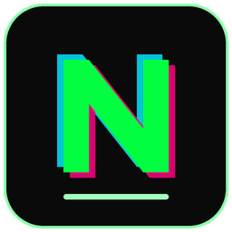

# SG Neo



**SG Neo is a theme released under the GNU GPL v3.**
The website that hosts it is released under the Apache License 2.0.

**Download:** https://sg-neo.sgdev.qd.je
Also available at: https://s-neo.qd.je (same website)

Neon-on-black VS Code theme, ported from the **SG Neo** Notepad++ theme and trimmed down to a minimal UI.

The editor keeps the Notepad++ colours. The workbench (sidebar, tabs, status bar, panels) stays flat and quiet, with grey text and thin borders. Neon green only shows up for the active tab, active activity icon and focus.

## Palette

| Role | Colour |
|---|---|
| Background | `#0A0A0A` |
| Text / identifiers | `#00FF41` |
| Keywords, tags, `True/False/None` | `#FF4D00` (bold) |
| Operators, caret | `#FF007F` |
| Classes, function definitions, types | `#CC00FF` (bold) |
| Strings | `#FFD700` |
| Numbers, constants, line numbers | `#00E5FF` |
| Decorators, preprocessor | `#FF8000` (bold) |
| Comments | `#007A29` (italic) |
| Current line / selection | `#1A1A1A` / `#404040` |

## Install

**From the .vsix**
1. Open VS Code, press `Ctrl+Shift+X`.
2. Click `...` (top right of the Extensions panel), then **Install from VSIX...** and pick `sg-neo-theme-1.0.0.vsix`.
3. `Ctrl+K Ctrl+T`, then choose **SG Neo**.

**From the folder (no packaging)**
Copy the `sg-neo-theme` folder to `%USERPROFILE%\.vscode\extensions\sgdev.sg-neo-theme-1.0.0`, restart VS Code, then pick **SG Neo**.

## Settings that match the look (optional)

```json
{
  "editor.fontFamily": "Consolas, 'Courier New', monospace",
  "editor.fontSize": 14,
  "editor.cursorBlinking": "smooth",
  "editor.minimap.enabled": false,
  "editor.renderLineHighlight": "line",
  "workbench.colorTheme": "SG Neo",
  "breadcrumbs.enabled": false
}
```

## Tweaking

Everything is in `themes/sg-neo-color-theme.json`. To override one colour without editing the theme, use `workbench.colorCustomizations` and `editor.tokenColorCustomizations` in your settings under the `"[SG Neo]"` key.

## Website

The download website is available at two addresses. Both open the same site:

- https://sg-neo.sgdev.qd.je
- https://s-neo.qd.je

## License

This repository uses two licenses:

| Part | License |
|---|---|
| **SG Neo theme / extension** (the theme files, `.vsix` and logo in this repository) | **GNU General Public License v3.0** (see `LICENSE`) |
| **Website** (sg-neo.sgdev.qd.je / s-neo.qd.je) | **Apache License 2.0** |

The theme is free software under the GNU GPL v3. The website that hosts the downloads is a separate project, licensed under Apache 2.0, and its license does not apply to the theme.

Website and downloads: https://sg-neo.sgdev.qd.je (also https://s-neo.qd.je)
